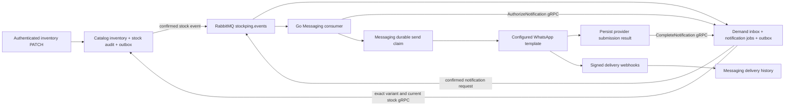

# Stage 4 — RabbitMQ stock notifications

Validation date: 2026-11-08 (Asia/Colombo). Branch: `feat/stage-4-stock-notifications`.

## Objective and scope

Implement the complete inventory -> RabbitMQ -> eligible waitlist -> WhatsApp template path, with durable state, duplicate prevention, PostgreSQL migrations, Docker integration and automated local acceptance. Existing REST inventory operations and HELP/STOCK/STOP behavior are preserved. No frontend redesign, cloud resource, deployment or real-provider test is part of automated acceptance.

## Final architecture



Each service connects only to its own PostgreSQL database. Catalog owns inventory and transition detection. Demand owns eligibility, consent, notification jobs and waitlist lifecycle. Messaging owns the provider, send claim, provider identifiers and delivery history. All service RPCs reuse existing dedicated credentials and deadlines. RabbitMQ uses the configured local broker credentials; the Compose network is a trusted development boundary, not a public deployment/TLS design.

There is no new permanent Docker service. Catalog and Demand each have a small scheduled outbox relay. The acceptance script creates a temporary fake-provider container and an isolated test project.

## Contracts and topology

| Routing key / JSON type | Queue | Dead-letter queue |
| --- | --- | --- |
| `inventory.stock_available.v1` | `demand.stock-available.v1` | `demand.stock-available.v1.dead` |
| `notification.requested.v1` | `messaging.notification-requested.v1` | `messaging.notification-requested.v1.dead` |

Both routes use durable direct exchange `stockping.events`. Dead letters use durable direct exchange `stockping.dead`, with the original queue name as routing key. Main and dead queues are durable quorum queues. Main queues set delivery limit 5, `x-dead-letter-strategy=at-least-once`, and `x-overflow=reject-publish`. Consumer prefetch is 1. Persistent messages use mandatory routing and correlated publisher confirms. Explicit acknowledgements follow committed application processing.

See the [versioned JSON schemas](../contracts/events/README.md). The stock event contains `eventId`, `eventType`, `eventVersion`, `occurredAt`, `merchantId`, `productId`, `variantId`, `sku`, `previousQuantity`, `newQuantity`, and `correlationId`. Its ID is the existing Catalog stock-audit ID. The notification event contains its stable event/job ID, availability-event ID, merchant ID, occurrence time and correlation ID. It deliberately contains no phone number. Messaging obtains current recipient/product information through authenticated `AuthorizeNotification`; it reports submission through `CompleteNotification`. These are additive methods in Demand v1 protobuf.

RabbitMQ's [quorum queue documentation](https://www.rabbitmq.com/docs/quorum-queues) describes delivery limits and at-least-once dead lettering. Consumers use `basic.reject` for failed attempts because newer RabbitMQ versions distinguish it from `basic.nack` when counting failures. The [Spring AMQP confirms documentation](https://docs.spring.io/spring-amqp/reference/amqp/template.html) informs the mandatory-return plus correlated-confirm check.

## Transactional outboxes and recovery

The existing Catalog inventory row lock serializes writes. Only `0 -> positive` creates an availability outbox row. Unchanged, positive-to-positive and depletion writes do not. A later restock creates a new audit/event ID. Inventory, audit and outbox commit together; a failed outbox insert rolls all three back.

Each publisher selects one due row using `FOR UPDATE SKIP LOCKED`, sends persistently, and waits up to three seconds for a positive confirm without a mandatory return. `PUBLISHED` is committed only after that confirmation. A crash after broker acceptance but before the database update can republish the same ID. Consumers are idempotent.

Failed attempts remain `PENDING` with exponential backoff (2 seconds initially, capped at 256 seconds by the current formula). A maximum of 20 failed attempts parks the row as `PARKED`; the payload and error code remain stored. The scheduled loop handles at most 20 rows per pass. Connections recover automatically; broker outages do not make the REST health check fail because inventory can still commit safely to the outbox.

Demand commits its inbox row, notification jobs, waitlist transitions and outgoing outbox rows in one transaction. Unknown/malformed versions go directly to dead letter. Retryable processing failures are rejected with requeue and one-second pacing; the quorum delivery limit prevents an unbounded poison-message loop. Connection reconnection continues while the service runs; per-message retries remain bounded.

## Eligibility and lifecycle

Demand resolves the active exact variant under the event's merchant and verifies the product association and current positive stock. Only `WAITING` entries created by the event time qualify. The merchant and customer must be active, and the latest append-only consent record must be `OPT_IN`. No customer is created and no consent is changed by this workflow. Opted-out, cancelled, expired, fulfilled, queued and already-notified waitlists are excluded. Every eligible waiter is notified; stock is not reserved and quantity-aware allocation is outside this stage.

`notification_jobs` has unique `(availability_event_id, customer_id)` and `(availability_event_id, waitlist_id)` constraints plus tenant/customer/waitlist foreign keys. Event replay cannot create another job. The existing partial unique active-waitlist index still applies.

Just before a provider attempt, Messaging calls Demand. Demand takes the same customer lock used by consent/STOP, verifies the job's immutable identity, checks the current waitlist and consent again, and rechecks authoritative stock over gRPC. Transient Catalog/RPC failure is retryable before the external-send claim. Unavailable stock skips the job and returns a still-queued waitlist to `WAITING`, permitting a later legitimate restock. STOP's `OPTED_OUT` state is never overwritten.

| Demand job | Meaning / waitlist behavior |
| --- | --- |
| `QUEUED` | Durable notification and outbox; waitlist is `NOTIFICATION_QUEUED`. |
| `AUTHORIZED` | Latest eligibility passed; not proof of a provider submission. |
| `ACCEPTED` | Provider returned a persisted message ID; queued waitlist becomes `NOTIFIED`. |
| `FAILED` | Definite provider rejection; queued waitlist becomes `CANCELLED`. |
| `UNKNOWN` | Provider outcome uncertain; queued waitlist becomes `CANCELLED` to prevent automatic repeats. |
| `SKIPPED` | Ineligible or unmapped recipient/channel; preserves STOP. Stock-unavailable skips return queued waitlists to `WAITING`; other skips cancel still-queued rows. |

`GET /api/notifications` returns the authenticated merchant's latest 100 submission jobs with IDs, reason, provider ID and timestamps. It does not expose another merchant's rows or claim delivery. The existing frontend waitlist state reflects `NOTIFIED`/`OPTED_OUT`; no optional notification UI was added.

## Messaging safety and actual guarantees

`notification_receipts` records the immutable notification identity, state, attempted/completed/reported timestamps and a send-attempt count constrained to 0 or 1. A conditional `RECEIVED -> SENDING` transaction inserts the outbound message record. Only its winner may call the provider. RabbitMQ redelivery and concurrent consumers reuse the receipt; terminal submissions are reported again without sending again.

Submission outcomes are persisted before Demand completion and broker acknowledgement. Provider timeouts, network errors, 5xx and malformed success responses are `UNKNOWN`; explicit rejections are `FAILED`. Neither is blindly retried. An interrupted `SENDING` claim is inspected after 30 seconds (beyond the configured provider deadline): a saved provider result is recovered, otherwise the receipt/message become `UNKNOWN`. A crash before the HTTP call after claiming can therefore lose a notification rather than risk sending twice. A crash after HTTP acceptance before saving the provider ID can leave an unknown result. This is **not exactly-once external delivery**.

If Demand completion repeatedly fails, the already persisted result stays in Messaging and the request eventually dead-letters. Operational replay reports that saved result without resending. Provider callbacks reuse existing `message_records`/`delivery_events` reconciliation, including duplicate/out-of-order callbacks and callbacks preceding persisted submission results. Delivery statuses are Messaging-owned; Demand's `ACCEPTED` stays a submission outcome.

Consent and inventory are point-in-time checks immediately before sending. An opt-out or depletion committed after authorization cannot recall an already in-flight external request. There is no distributed transaction with Meta or cross-service database lock. Queued work revalidates consent, and STOP committed before that check suppresses the send.

## Template and configuration requirements

The existing Meta client submits `type=template` with the configured name, language and positional text body parameters. There is no free-text fallback for automatic alerts. The [Meta-owned template API example](https://www.postman.com/meta/whatsapp-business-platform/request/o65u5m5/send-message-template-text) documents this request shape. Actual template wording, approval, language and variable order must be supplied by the operator. Include exact variant information and an appropriate opt-out instruction in the approved template; do not imply a reservation.

New settings in `.env.example`:

- `STOCK_EVENTS_ENABLED=true` in Compose enables both Java relays and the stock consumer; native defaults are false. Event creation remains transactional even when relays are disabled.
- `STOCK_NOTIFICATIONS_ENABLED=false` by default gates the Go automatic consumer independently of Stage 3 webhooks.
- `WHATSAPP_STOCK_TEMPLATE_NAME`, `WHATSAPP_STOCK_TEMPLATE_LANGUAGE`, `WHATSAPP_STOCK_TEMPLATE_PARAMETERS` must match the approved positional-body template. Allowed ordered fields are `product_name`, `sku`, `variant_description`; include SKU or variant description. Unsupported, duplicated or absent fields block automatic consumption.
- Real-provider testing additionally requires `WHATSAPP_STOCK_REAL_SEND_ENABLED=true` and `WHATSAPP_STOCK_ALLOWED_RECIPIENTS` with explicitly authorized canonical international numbers. This educational implementation keeps that allowlist requirement for every real automatic alert.
- RabbitMQ host, port and credentials are passed to the three existing services. Native Java/Go default to localhost:5673; Compose uses rabbitmq:5672.

`GET /health/notifications` and startup logs expose a non-sensitive configuration status: `disabled`, `provider_disabled`, `template_configuration_required`, `real_sending_disabled` or `ready`. Missing configuration leaves messages in RabbitMQ. `ready` means configuration permits consuming, not proof of Meta approval or live broker health. Existing Stage 3 HELP/STOCK/STOP replies remain enabled independently. No real secrets or root `.env` values are changed.

## Migrations

| Owner | Migration | Additions |
| --- | --- | --- |
| Catalog | `V2__stock_outbox.sql` | `event_outbox` referencing stock audit, due-row index. |
| Demand | `V3__stock_notifications.sql` | `availability_events`, `notification_jobs`, `event_outbox`, tenant/business-key constraints and indexes. |
| Messaging | `002_notifications.sql` | `notification_receipts`, optional notification origin on `message_records`, exclusive origin constraint and recovery index. |

All migrations are additive PostgreSQL migrations. Existing rows, checksums and service ownership remain. Go's migration runner now applies all numbered embedded migrations, checking each checksum transactionally under its existing advisory lock.

## Operator inspection and recovery

Use the service's own database role to inspect `event_outbox` pending/parked counts and oldest `created_at`; Demand's `notification_jobs` by state; Messaging's `notification_receipts` and `message_records`; and RabbitMQ's queue/dead-letter depths. Logs contain identifiers and fixed error codes, not recipients, payloads or credentials. The management UI is loopback-bound in Compose.

After correcting a broker/configuration issue, a reviewed parked outbox row can be reset in its owning database:

```sql
UPDATE event_outbox
SET status='PENDING', attempts=0, next_attempt_at=now(), error_code=NULL
WHERE id='<reviewed UUID>' AND status='PARKED';
```

For a reviewed dead letter, correct the dependency/configuration first, then republish its original body and stable ID to the original `stockping.events` routing key. Do not invent a new event/job ID to bypass duplicate prevention. Verify the durable outcome before removing the original dead letter. Malformed/unsupported messages need correction at the producer, not repeated replay. Replaying an uncertain provider outcome does not send again; reconcile it operationally using provider records. Do not reset `SENDING`/`UNKNOWN` receipts to `RECEIVED`.

This is a local single-node broker with persistent volumes, not a multi-node high-availability deployment. Long-running outbox exhaustion and dead letters need operator intervention. There is no automatic retention/purge job; data is retained for inspection. Notification fan-out is one transaction per event and is suitable for portfolio-scale waitlists; very large fan-outs would need bounded database batches before production scale.

## Verification commands

From the repository root, with Docker running and JDK 21/Maven/Node 24 available:

```sh
./scripts/test.sh
docker compose build
python3 scripts/validate-stage4.py

# Existing local stack and Stage 0-3 regressions:
docker compose up -d --wait --wait-timeout 180
python3 scripts/smoke-test.py
python3 scripts/validate-catalog.py
python3 scripts/validate-demand.py
python3 scripts/validate-messaging.py
```

Stage 4 acceptance uses prebuilt `stockping-*-service:latest` images. It creates a unique `stockping-stage4-<random>` Compose project, unique loopback ports, synthetic credentials, a fake provider and fresh PostgreSQL/RabbitMQ volumes. The normal project's `.env`, services and data remain untouched. A `finally` block deletes only the generated test project/volumes and fake container. Assertions use bounded polling. Failure diagnostics are saved privately under the host temporary directory. No live Meta access token is needed.

## Observed results and acceptance

Stage 4 implementation and local verification are fully complete. All test suites and end-to-end acceptance scenarios were executed and passed:

1. **Java Full Regression (`./scripts/test.sh` / `mvn -B -ntp clean verify`)**:
   - Total: **157 tests passed; 0 failures, 0 errors, 0 skipped** across all 4 Java reactor modules (increased from 140 in Stage 3; 17 new tests added, 0 removed or weakened).
   - `stockping-contracts`: 2 tests passed (`ProbeContractTest`, `CatalogContractTest`).
   - `stockping-security`: 12 tests passed (`TokenConfigurationTest`).
   - `catalog-service`: 43 tests passed (up from 41 in Stage 3; 2 new integration tests covering availability transition detection and outbox persistence).
   - `demand-service`: 100 tests passed (up from 85 in Stage 3; 15 new integration tests in `NotificationIntegrationTest` covering eligibility, consent, idempotency, and outbox creation).
   - Script `./scripts/test.sh` completed with exit code 0.

2. **Frontend Test Suite & Production Build**:
   - `vitest run`: 12 tests passed covering merchant login, waitlist loading/filtering/rendering, and confirmed opt-out.
   - `tsc -b && vite build`: compiled production bundles without warnings.

3. **Go Messaging Verification**:
   - `gofmt` and `go vet`: clean.
   - `go test -race ./...`: all unit test suites in `internal/config`, `internal/contracts`, `internal/http`, `internal/rabbitmq`, and `internal/whatsapp` passed with the race detector enabled.
   - Containerized build of `cmd/messaging`, `catalog-grpc-check`, and `demand-grpc-check` succeeded.

4. **Messaging Database Integration (`./scripts/test-messaging-db.sh`)**:
   - Executed against a disposable PostgreSQL container.
   - Verified schema migration `002_notifications.sql` with checksum validation under advisory locks.
   - Passed `TestNotificationConcurrentClaimsAndReplaySendOnce`, `TestNotificationFailureAndUncertaintyNeverResend`, `TestNotificationConsentAndChannelSuppressSending`, `TestNotificationInternalFailureRecoversBeforeClaim`, `TestInterruptedNotificationRecoveryNeverCallsProvider`, and all signed webhook tests.

5. **Stage 4 End-to-End Acceptance (`python3 scripts/validate-stage4.py`)**:
   - Ran in an isolated Compose project (`stockping-stage4-*`) with synthetic credentials, unique loopback ports, and a controlled mock WhatsApp provider.
   - `PASS`: Concurrent inventory PATCH commits exactly one outbox row and publishes a single availability event to RabbitMQ.
   - `PASS`: Demand identifies eligible waitlisted customer and queues notification request.
   - `PASS`: Messaging calls `AuthorizeNotification`, claims the send, submits template notification to fake provider, and records `ACCEPTED` provider message ID.
   - `PASS`: Duplicate event replay, notification request replay, and Messaging consumer restart acknowledge duplicate deliveries without repeating external sends.
   - `PASS`: Outbound template status callback (`READ`) reconciles in Messaging delivery history.
   - `PASS`: Positive-to-positive quantity changes and depletion produce no availability events; subsequent restock produces a distinct event; already-notified waitlist entries are suppressed.
   - `PASS`: Missing template operational gate blocks consumption with clear status (`template_configuration_required`); queued `STOP` opt-out before send suppresses the alert upon gate opening.
   - `PASS`: Fan-out to multiple eligible waiters generates separate durable notification jobs.
   - `PASS`: Cross-merchant isolation prevents notifications from reaching another tenant's channel.
   - `PASS`: Provider rejection (`FAILED`) and 503 error (`UNKNOWN`) persist distinct terminal states; neither is blindly retried.
   - `PASS`: RabbitMQ broker outage preserves committed outbox rows; reconnection publishes and delivers pending events after broker restart.
   - `PASS`: Transient Catalog gRPC outage during consumption routes event to dead-letter queue after bounded retries; poison/invalid event versions dead-letter without crashing consumers.
   - Complete isolated test suite passed; disposable containers and volumes were removed with zero pollution of the main environment.

6. **Stage 0–3 Regression Verification**:
   - `python3 scripts/smoke-test.py`: All 8 HTTP and database health/isolation checks passed.
   - `python3 scripts/validate-catalog.py`: Catalog REST restock transitions and gRPC inventory resolution passed.
   - `python3 scripts/validate-demand.py`: Authentication, waitlists, consent history, Catalog outage handling, and logout passed.
   - `python3 scripts/validate-messaging.py`: All 8 signed WhatsApp webhook, HELP/STOCK/STOP handling, and delivery callback reconciliation scenarios passed.

### Real Meta WhatsApp Cloud API Acceptance
Real Meta Cloud API testing requires an active Meta Business Account, an approved template (e.g. matching `WHATSAPP_STOCK_TEMPLATE_NAME` and parameters), and explicit configuration of `WHATSAPP_STOCK_REAL_SEND_ENABLED=true` with authorized international numbers in `WHATSAPP_STOCK_ALLOWED_RECIPIENTS`. As defined by project specifications, automated local acceptance safely mocks the external provider so no external Meta credentials or live charges are required.
