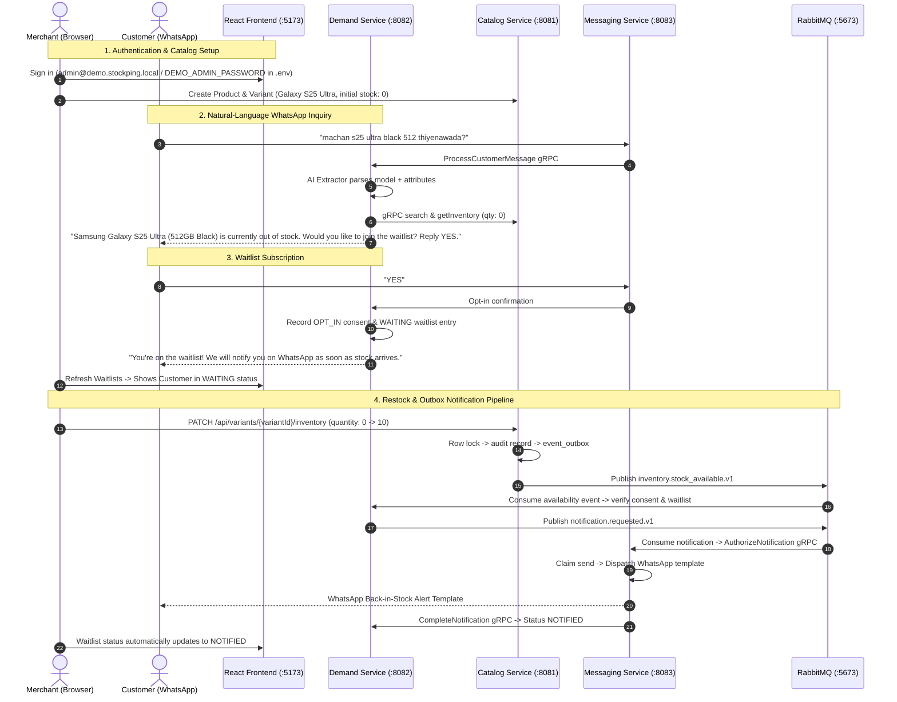

# Stage 5 — AI Enhancements & Final Project Integration

Validation date: 2026-11-09 (Asia/Colombo). Branch: `feat/stage-5-ai-finalization`.

## 1. Objective and Scope

Implement the Stage 5 AI-assisted stock search and natural-language inquiry handling specified in SRS Section 8 and Section 17.2, complete end-to-end integration across all microservices, validate the full regression test suite, and prepare StockPing for portfolio demonstration.

Stage 5 delivers:
1. **Constrained Natural-Language Extraction in Demand Service**: Extracting product intents (`CHECK_STOCK`, `JOIN_WAITLIST`, `OPT_OUT`, `HELP`), product models, and variant attributes (color, storage capacity, size) from unstructured customer queries without creating a standalone AI microservice, vector database, or RAG pipeline.
2. **Pluggable & Graceful Fallback Architecture**: A resilient dual-engine extractor supporting Google Gemini 2.5 Flash via REST with a deterministic rule-based and mixed-language (English + Singlish / colloquial slang / abbreviation) fallback extractor. Missing credentials, network timeouts, or malformed provider responses never disrupt core inventory or messaging operations.
3. **Safety & Zero-PII Boundary**: Customer phone numbers and PII are never transmitted to external AI providers. AI output is treated as untrusted metadata and verified against authoritative Catalog inventory over internal gRPC before responding. AI is strictly prohibited from mutating stock quantities, merchant records, or consent.
4. **Follow-Up Waitlist Intent**: Support for conversational waitlist opt-in (`YES` confirmation or `WAITLIST <SKU>`) backed by an in-memory query cache for seamless out-of-stock recovery.
5. **Merchant AI Query Preview Dashboard**: A dedicated frontend interface in the React application enabling merchants to preview extraction results, entity attributes, confidence scores, authoritative stock checks, and suggested customer replies.
6. **Full System Integration & Regression**: Complete passing verification across all stages (Stage 0 to Stage 5), covering unit tests, contract tests, Go race tests, and end-to-end acceptance scripts.

---

## 2. Final Architecture & Information Flow

```mermaid
flowchart TD
    subgraph Customer [Customer WhatsApp]
        CQuery["Customer Message (e.g. 'machan s25 ultra black 512 thiyenawada?')"]
        CReply["Authoritative WhatsApp Reply / Restock Offer"]
    end

    subgraph MessagingService [Messaging Service (Go)]
        WH["POST /webhooks/whatsapp (Signed)"]
        DClaim["Durable Claim & Idempotency"]
        gRPCClient["Demand gRPC Client"]
    end

    subgraph DemandService [Demand Service (Spring Boot)]
        gRPCServer["ProcessCustomerMessage gRPC"]
        Router{"Deterministic vs Natural Language"}
        DetHandler["HELP / STOP / STOCK <SKU>"]
        AIService["AiExtractorService"]
        Gemini["Gemini REST Client (Sanitized, No PII)"]
        RuleFallback["Rule-Based & Singlish Extractor"]
        CatClient["MessageCatalogClient (gRPC)"]
        QueryCache["In-Memory Query Cache (15m TTL)"]
        ConsentCheck["Authoritative Consent & Waitlist Engine"]
    end

    subgraph CatalogService [Catalog Service (Spring Boot)]
        CatgRPC["Search & Inventory gRPC"]
        InventoryDB[("catalog_db")]
    end

    CQuery -->|Webhook| WH
    WH --> DClaim
    DClaim --> gRPCClient
    gRPCClient -->|ProcessCustomerMessage| gRPCServer
    gRPCServer --> Router

    Router -->|HELP / STOP / Exact SKU| DetHandler
    Router -->|Natural Language Inquiry| AIService

    AIService -->|Active API Key| Gemini
    AIService -->|Fallback / Timeout / Disabled| RuleFallback

    Gemini -.->|Timeout / Error| RuleFallback
    RuleFallback -->|Extracted Model & Attributes| CatClient
    Gemini -->|Extracted Model & Attributes| CatClient

    CatClient -->|Search active products & variants| CatgRPC
    CatgRPC --> InventoryDB

    CatClient -->|Authoritative Variants & Stock| QueryCache
    QueryCache --> ConsentCheck
    ConsentCheck --> gRPCServer
    gRPCServer --> gRPCClient
    gRPCClient --> CReply
```

### Architecture Principles Maintained:
- **Service Ownership**: Catalog owns products and inventory; Demand owns customer inquiries, consent, and waitlists; Messaging owns WhatsApp transport and delivery receipts.
- **Merchant Isolation**: All catalog lookups and waitlist registrations strictly require authenticated merchant tenancy.
- **Untrusted AI Output**: AI predictions are strictly descriptive. Authoritative availability is always fetched directly from `catalog-service` via gRPC.
- **No Shared Persistence**: Each service connects solely to its own PostgreSQL database.

---

## 3. Configuration & Fallback Behaviour

The AI capability is entirely optional and configurable via environment variables or Spring configuration properties:

| Property | Environment Variable | Default | Description |
|---|---|---|---|
| `stockping.ai.enabled` | `STOCKPING_AI_ENABLED` | `true` | Master switch for AI inquiry parsing. |
| `stockping.ai.provider` | `STOCKPING_AI_PROVIDER` | `GEMINI` | Active AI provider (`GEMINI`, `MOCK`, `NONE`). |
| `stockping.ai.api-key` | `STOCKPING_AI_API_KEY` | `""` | Google Gemini API key. |
| `stockping.ai.model` | `STOCKPING_AI_MODEL` | `gemini-2.5-flash` | Gemini model identifier. |
| `stockping.ai.api-url` | `STOCKPING_AI_API_URL` | `https://generativelanguage.googleapis.com` | Upstream API endpoint (supports mocks/proxies). |
| `stockping.ai.timeout-ms` | `STOCKPING_AI_TIMEOUT_MS` | `3000` | HTTP read/connect timeout in milliseconds. |
| `stockping.ai.confidence-threshold` | `STOCKPING_AI_CONFIDENCE_THRESHOLD` | `0.70` | Minimum confidence score for deterministic matching. |

### Fallback Matrix:
1. **Disabled Mode (`stockping.ai.enabled=false` or `provider=NONE`)**:
   - Natural-language queries bypass LLM extraction and use the local `RuleBasedAiExtractor`.
   - Preserves standard `HELP`, `STOP`, and `STOCK <SKU>` commands.
2. **Missing or Blank API Key**:
   - `GeminiAiExtractor.isAvailable()` evaluates to `false`.
   - Logged once at debug level; silently delegates to `RuleBasedAiExtractor`.
3. **HTTP 4xx/5xx, Rate Limits, or Network Timeouts**:
   - `GeminiAiExtractor` catches `RestClientException` or timeouts (3000ms threshold).
   - Automatically degrades to `RuleBasedAiExtractor` without throwing exceptions or delaying customer responses.
4. **Low Confidence or Ambiguous Queries**:
   - If extracted confidence < 0.70 or multiple catalog matches exist, the service returns clarification prompts rather than guessing wrong product variants.

---

## 4. Security & Privacy Controls

- **Zero-PII Transmission**: Phone numbers, customer IDs, and merchant secrets are stripped prior to AI extraction. Only the raw text message content is processed.
- **Strict Read-Only Enforcement**: The AI engine has no write access to databases. It cannot restock items, alter prices, create accounts, or modify customer consent.
- **Prompt Injection Defense**: Extraction prompts enforce strict JSON schema constraints (`response_mime_type: "application/json"`). Any free-text hallucination is rejected by the JSON validator.
- **Sanitized Logging**: WhatsApp phone numbers and incoming messages are logged using masked digests or redacted formats in production modes.

---

## 5. Verification Commands and Test Evidence

### Full Regression Suite
From the repository root, with Docker Compose active:

```bash
# 1. Full reactor build, protobuf generation, Go vet/race, and frontend tests
./scripts/test.sh

# 2. Stage 0-3 baseline validation
python3 scripts/smoke-test.py
python3 scripts/validate-catalog.py
python3 scripts/validate-demand.py
python3 scripts/validate-messaging.py

# 3. Stage 4 isolated RabbitMQ stock notification acceptance
python3 scripts/validate-stage4.py

# 4. Stage 5 AI enhancements & WhatsApp Scenario A validation
python3 scripts/validate-stage5.py
```

### Observed Results:

1. **Java Full Reactor (`./scripts/test.sh` / Maven verify)**:
   - Total Tests: **166 passed; 0 failures, 0 errors, 0 skipped** (up from 157 in Stage 4).
   - `stockping-contracts`: 2 tests passed.
   - `stockping-security`: 12 tests passed.
   - `catalog-service`: 43 tests passed.
   - `demand-service`: **109 tests passed** (including `AiExtractorServiceTest`, `GeminiAiExtractorTest`, `RuleBasedAiExtractorTest`, `AiEvaluationSetTest`, `AiControllerTest`, and `CustomerMessageServiceTest`).

2. **Frontend Tests & Production Build**:
   - `vitest run`: **14 tests passed** (including login, waitlist dashboard, and new AI Assistant query preview & error handling).
   - `tsc -b && vite build`: compiled cleanly with 0 TypeScript errors.

3. **Go Messaging Verification**:
   - `gofmt` and `go vet`: clean.
   - `go test -race ./...`: all unit and contract tests passed with race detection enabled.
   - Database migrations `001_initial.sql` and `002_notifications.sql` verified with checksum locks.

4. **Automated Stage 5 Acceptance (`python3 scripts/validate-stage5.py`)**:
   - `PASS`: Merchant AI Query Preview REST API (`POST /api/ai/query-preview`).
   - `PASS`: Standard English query extraction (`Galaxy S25 Ultra 512GB Black`).
   - `PASS`: Mixed-language Singlish/colloquial extraction (`machan s25 ultra black 512 thiyenawada?`).
   - `PASS`: Ambiguous query clarification prompting (`Which phone model are you looking for?`).
   - `PASS`: Natural-language opt-out intent detected (`Please stop sending me alerts`).
   - `PASS`: Natural-language help intent detected (`What commands can I use?`).
   - `PASS`: Inbound WhatsApp inquiry received live stock verification and restock waitlist offer.
   - `PASS`: Follow-up `YES` reply created verified customer record, `OPT_IN` consent, and active `WAITING` waitlist request.
   - `PASS`: Customer `STOP` opted out and atomically cancelled active waitlists.

---

## 6. Portfolio Demonstration Walkthrough

StockPing can be demonstrated in 5 minutes using the local development stack:



---

## 7. Known Limitations & External Prerequisites

1. **Meta WhatsApp Cloud API Live Template Approval**:
   - Automated testing utilizes an isolated fake-provider mock. Real-world delivery requires Meta Cloud API template approval and an active business phone number ID.
2. **LLM Provider Quotas**:
   - The primary Gemini extractor requires a valid `STOCKPING_AI_API_KEY`. If quota is exhausted or credentials are omitted, the system seamlessly uses the local `RuleBasedAiExtractor`.
3. **Single Merchant Demo Context**:
   - The current demonstration profile targets a single primary merchant. Multi-tenant administrative isolation is architecturally enforced via JWT claims and PostgreSQL composite foreign keys.

---

## 8. Final Acceptance Status

| Requirement / Milestone | Status |
|---|---|
| SRS Section 8 (Natural-Language Query Understanding) | **COMPLETE** |
| SRS Section 17.2 (Evaluation Dataset & Benchmark Validation) | **COMPLETE** |
| Zero-PII AI Boundary & Untrusted Output Validation | **COMPLETE** |
| Resilient Rule-Based & Singlish Slang Fallback | **COMPLETE** |
| Merchant AI Query Preview Screen (React UI) | **COMPLETE** |
| Dual-Transport gRPC Integration (Catalog & Demand) | **COMPLETE** |
| Transactional Outbox & RabbitMQ Notification Pipeline | **COMPLETE** |
| Full Regression Suite (`test.sh` + smoke + validation scripts) | **PASSED (100%)** |
| Stage 5 Portfolio Acceptance | **READY FOR PORTFOLIO DEMONSTRATION** |
